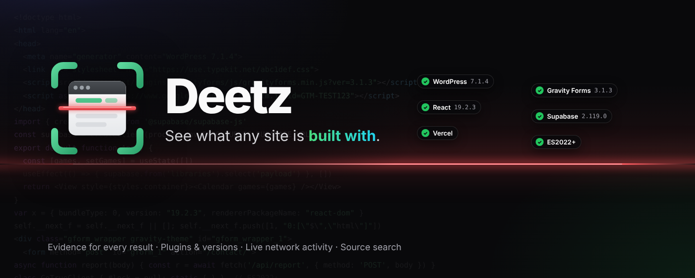
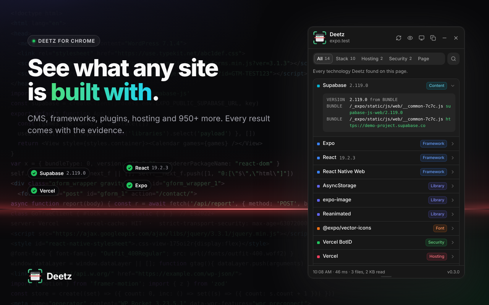
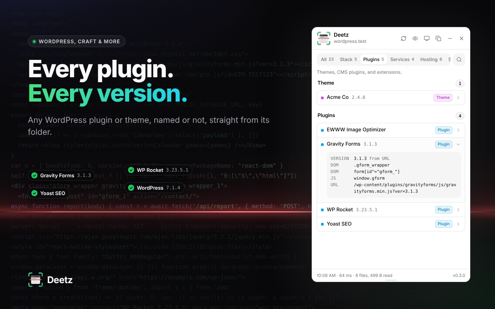
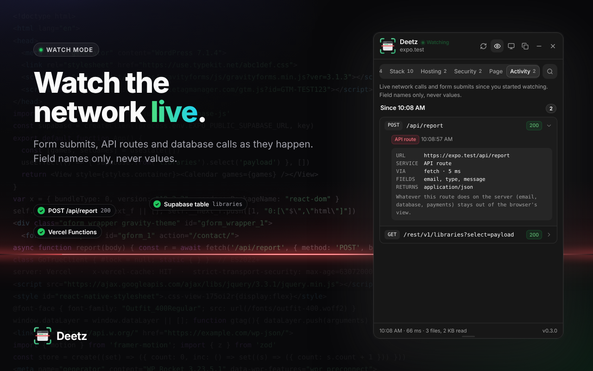
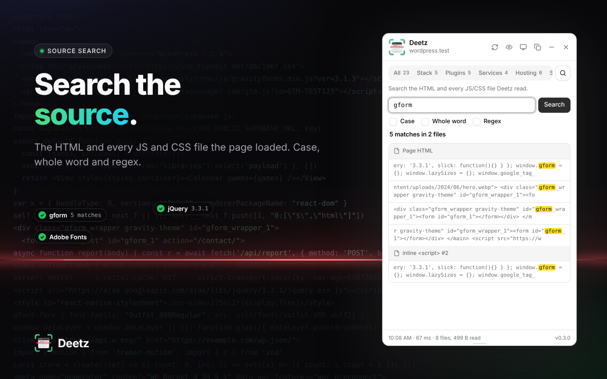
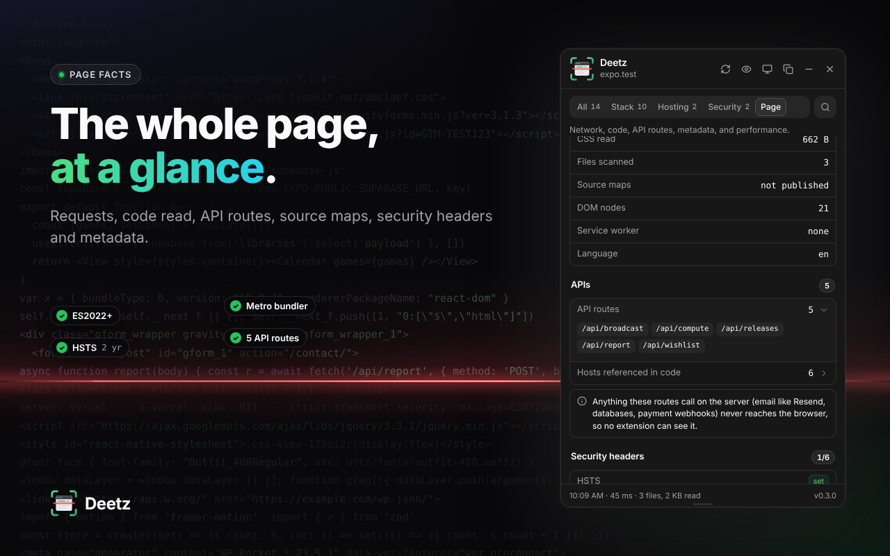

<p align="center">
  
</p>

<p align="center">
  <strong>A compact Web Application Specifications panel for Chrome.</strong><br>
  See the CMS, frameworks, plugins, hosting and more behind any page, with the evidence.
</p>

<p align="center">
  <a href="LICENSE"></a>
  
  
  
</p>

---

<p align="center">
  
</p>

## Why Deetz

Technology profilers like Wappalyzer list what a page loaded. Deetz also tells you **why**, **where it came from**, and **what it can't see**:

- **Evidence for every item.** Open a row to see the exact file, header, selector, cookie, global or code signature that matched, and where the version number came from.
- **Provenance.** "jQuery 3.3.1 via ajax.googleapis.com", "LazySizes via EWWW Image Optimizer", "React via WordPress core".
- **It reads the bundles.** Libraries compiled into a site's own JavaScript (supabase-js, React DOM, Reanimated, Zod, TanStack…) are found with their versions, along with the language level and bundler.
- **Any WordPress plugin or theme**, named or not, straight from its folder, plus the theme's real name, version and author.
- **Honest limits.** Services that only run on a server, like an email provider behind `/api/contact`, never reach the browser. Deetz lists the routes and says so instead of guessing.

## Features

| | |
|---|---|
| **Tabs** | All · Stack · Plugins · Services · Hosting · Security · Page · Activity, with Search pinned on the right. Empty tabs hide themselves. |
| **Evidence** | Click any row: tags, provenance, version source, and every signal that matched. Heuristic-only matches are marked _likely_; inferred ones _implied_. |
| **Late loaders** | Tag managers, analytics and widgets that load after the page are picked up automatically while the panel is open. |
| **Watch & Activity** | Rescans when the page changes and logs network calls and form submits live: method, path, status, timing, and field names (never values). |
| **Source search** | Search the HTML and every JS/CSS file Deetz read. Case, whole word and regex. |
| **New & gone** | Compared with your previous visit to the site. |
| **Export** | Copy as Markdown or JSON. |
| **Page facts** | Protocol, requests, transfer size, third-party hosts, JS/CSS read, source maps, API routes, hosts referenced in code, security header checklist, metadata. |
| **Comfort** | Light/Dark/System themes, draggable and resizable panel that remembers its place, minimize to a pill, keyboard shortcut. |
| **Toolbar** | Material-style icon that follows Chrome's theme, with a count badge drawn in shadcn style. |

<table>
  <tr>
    <td></td>
    <td></td>
  </tr>
  <tr>
    <td></td>
    <td></td>
  </tr>
</table>

## What it detects

About 950 rules across 20 categories, plus detectors that need no list (any WordPress plugin or theme, any Shopify app, fonts in use, language level, source maps, security headers):

- **CMS:** WordPress, Craft CMS, Drupal, Joomla, Ghost, Strapi, Payload, Directus, KeystoneJS, ApostropheCMS, Statamic, Kirby, TYPO3, AEM, Sitecore, Umbraco, Webflow, Squarespace, Wix, Framer, HubSpot CMS, and more.
- **Plugins & themes:** every WordPress plugin and theme from its folder (including must-use plugins and Bedrock layouts), named fingerprints for 80+ popular plugins, Craft plugins (Formie, Freeform, Blitz, SEOmatic), and Shopify apps: 75+ by name, plus any other app on a Shopify store found by its script host.
- **Content & data sources:** Supabase (with the tables a page queries), Sanity, Contentful, Storyblok, Prismic, DatoCMS, Hygraph, Firebase, Cloudinary, imgix, Mux.
- **Frameworks:** Next.js (App Router vs Pages Router), Nuxt, Remix, React Router, Gatsby, SvelteKit, Astro, Angular, Vue, React, Preact, Svelte, Solid, Qwik, htmx, Alpine, Hotwire, Livewire, Inertia, Expo and React Native Web, Flutter Web.
- **Libraries:** jQuery family, Lodash, GSAP, Three.js, Chart.js, D3, Swiper, Lottie, plus bundle-only finds like Zod, Redux, Zustand, TanStack Query/Table, Axios, Immer, i18next, Apollo, Socket.IO, CodeMirror.
- **Build & language:** JavaScript language level, ES modules, Metro, webpack, Vite, Turbopack, Babel output; TypeScript and npm packages when source maps are published; static site generators.
- **Fonts:** families actually in use with weights and source, Font Awesome, Adobe Fonts, Google Fonts.
- **Services:** analytics (with GA4/GTM/pixel IDs), monitoring and error tracking, tag managers, email-signup and marketing automation, personalization and A/B testing, chat and support, reviews, search, forms, maps, media and social embeds.
- **Advertising & affiliate:** AdSense (with publisher ID), Ad Manager, Prebid, Criteo, Taboola, Outbrain, Mediavine, Raptive, Ezoic, Amazon, Xandr, Magnite, Awin, CJ, Impact, ShareASale, Skimlinks, and more.
- **Payments:** Stripe, PayPal, Klarna, Afterpay, Affirm, Adyen, Braintree, Mollie, Paddle, Lemon Squeezy, Razorpay, Shop Pay, Apple Pay, Google Pay.
- **AI & ML:** client-side calls to OpenAI, Anthropic, Gemini, Mistral, Groq and Cohere; TensorFlow.js, Transformers.js, ONNX Runtime Web, MediaPipe, WebLLM; chatbots like Botpress, Voiceflow and Chatbase; sites built with Lovable, Bolt, v0, Replit and Claude artifacts.
- **Privacy & access:** consent platforms, IAB TCF / US Privacy / GPP APIs, Google Consent Mode, accessibility overlays, bot protection (Cloudflare, DataDome, HUMAN, Imperva, Akamai), and auth (Clerk, Auth0, Okta, MSAL, Stytch, Better Auth, Sign in with Google/Apple).
- **Hosting, server & security:** Vercel (and Vercel Functions, BotID), Netlify, Cloudflare (Pages, Workers), Fastly, Akamai, AWS (CloudFront, S3, ELB, API Gateway, Lambda, Amplify), Firebase, Railway, Deno Deploy, WP Engine, Kinsta, Pantheon; Nginx, Apache, LiteSpeed, Envoy, HAProxy, Traefik, Tomcat, Jetty, Uvicorn, PHP, Express, Laravel, Django, Flask, Rails, Spring, ASP.NET; security headers.

## Install

### From the Chrome Web Store
_Coming soon._

### From source
1. Clone or download this repository.
2. Open `chrome://extensions` and turn on **Developer mode**.
3. Click **Load unpacked** and choose the repository folder.
4. Pin Deetz, open any site, and click its icon (or press **Alt+Shift+D**).

After pulling changes, click ↻ on the Deetz card in `chrome://extensions`, then reload the page you're scanning.

## Usage

| Control | What it does |
|---|---|
| Toolbar icon / **Alt+Shift+D** | Open → restore from minimized → close |
| ⟳ | Rescan now |
| 👁 Watch | Rescan on page changes and log network activity (opens the Activity tab) |
| ☀ / ☾ / 🖥 | Theme: Light, Dark, or follow the system |
| ⧉ | Copy results as Markdown or JSON |
| – | Minimize to a draggable pill |
| Header | Drag to move |
| Bottom edge · left edge · corner | Drag to resize; double-click to reset |

## How it works

```
toolbar click ─► background.js ─► injects rules.js + detect.js + panel.js into the tab (isolated world)
                      ▲                              │
                      ├── "deetz:globals" ───────────┤  reads window.* in the page's MAIN world
                      └── "deetz:nethook" ───────────┘  Watch mode: observes fetch / XHR / sendBeacon
```

A scan gathers, all inside the browser:

1. **URLs** from the DOM and the Performance API (scripts, styles, images, fonts, fetch/XHR).
2. **HTML, meta tags, cookie names**, and **response headers** (a same-origin re-request of the page).
3. **JS globals** from the page's own world, plus React and Vue instances attached to DOM nodes.
4. **Code:** the full text of the page's JS and CSS (same-origin and CORS-friendly CDNs), used for bundle signatures, license banners, language level, API routes and source maps.
5. **Fonts** from `document.fonts`.

Then rules match, derived detectors run (WordPress folders, fonts, language level, source maps, security headers, Supabase traffic), provenance is attached, and implications are added (WordPress implies PHP and MySQL).

| Path | Role |
|---|---|
| [`src/rules.js`](src/rules.js) | Declarative detection rules; format documented at the top |
| [`src/detect.js`](src/detect.js) | Detection engine and source search. No `chrome.*` APIs, so it runs in any page |
| [`src/panel.js`](src/panel.js) | The panel UI: shadcn/ui's design system in plain DOM, inside a closed Shadow DOM in the browser's top layer |
| [`src/background.js`](src/background.js) | Service worker: injection, MAIN-world readers, network hook, toolbar icon and badge |
| [`design/`](design) | SVG masters for every icon, and the renderer |
| [`tests/`](tests) | End-to-end tests and fixture sites |
| [`docs/`](docs) | Privacy policy, store listing kit, store assets |

## What it can't see

Deetz only knows what reaches the browser. It **can't** see:

- DNS providers, domain registrars and email-security records (DMARC, SPF). Those need server-side DNS lookups, which Deetz doesn't do so it never sends your browsing anywhere.
- Developer-only tools such as Jest, Vitest, Playwright and Cypress. They run in development and don't ship to production pages.

- Services called only from a server: email (Resend, SendGrid, Postmark), databases, payment webhooks, queues.
- Server-side frameworks that leave no trace in HTML, headers or cookies.
- Anything behind a login you haven't passed, or code that hasn't loaded yet (use Watch while you click around).
- Source-level details (TypeScript, exact package list) unless the site publishes source maps.

When a page calls API routes, the Page and Activity tabs say so explicitly.

## Privacy

Deetz has no servers, no analytics and no accounts. It runs only when you click it, analyzes everything locally, and sends nothing to its developer or anyone else. Its only network requests go to the site you're viewing (to read headers and the site's own JS/CSS). Watch mode shows field **names**, never values.

Permissions: `activeTab`, `scripting`, `storage`. No host permissions. Full details in the [privacy policy](docs/PRIVACY.md).

## Development

No build step: the extension is plain JavaScript.

```bash
npm install
npx playwright install chromium   # once, for tests and asset rendering

npm run check     # syntax-check every source file and the manifest
npm test          # end-to-end tests (116 checks across WordPress, Next.js, Craft CMS, Shopify, Expo and a kitchen-sink fixture)
npm run icons     # re-render icons/*.png from design/*.svg
npm run package   # build dist/deetz-<version>.zip for the Chrome Web Store
node scripts/store-assets.mjs   # regenerate store screenshots and promo tiles
```

`npm test` loads the real extension into Chromium, serves the fixture sites offline, and checks detections, versions, provenance, late-load pickup and the Activity log (including that field values never appear).

See [CONTRIBUTING.md](CONTRIBUTING.md) for adding rules, tests and the release process, and [docs/STORE_LISTING.md](docs/STORE_LISTING.md) for the Chrome Web Store submission kit.

## Roadmap

- Optional always-on mode (opt-in host permission) for a live count on every tab
- Chrome Side Panel view
- Craft CMS plugin detection from `/cpresources/` assets
- Compare with a Wappalyzer CSV export: what each tool found that the other missed
- Per-site history timeline

## License

[MIT](LICENSE) © Joey Driscoll. Icons from [Lucide](https://lucide.dev) (ISC); visual design follows [shadcn/ui](https://ui.shadcn.com) (MIT). See [THIRD_PARTY_NOTICES.md](THIRD_PARTY_NOTICES.md).

Technology names are trademarks of their respective owners. Deetz is not affiliated with any of them.
